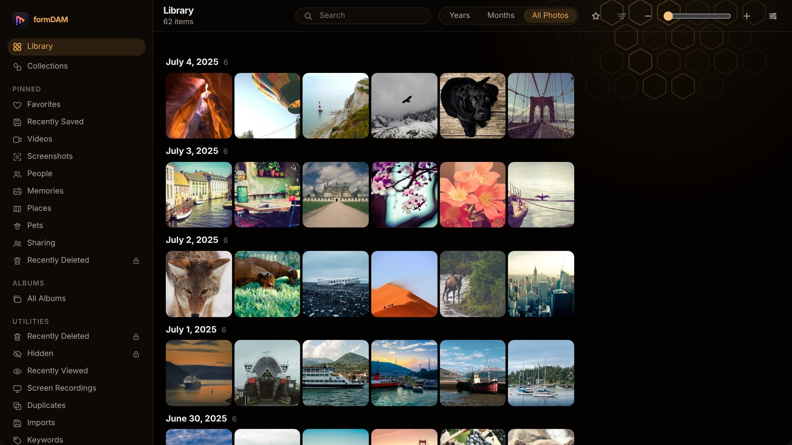
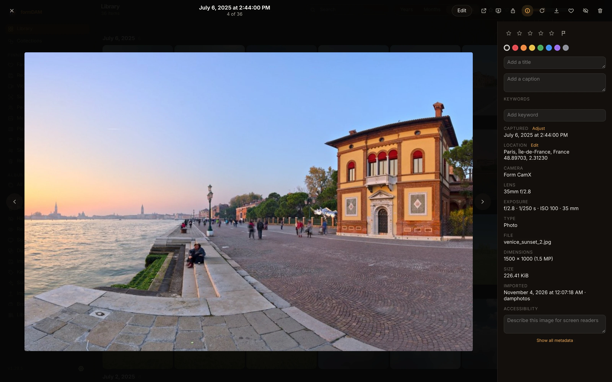
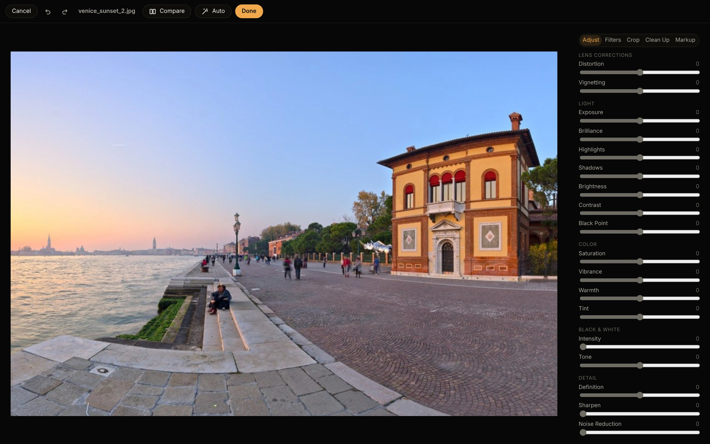
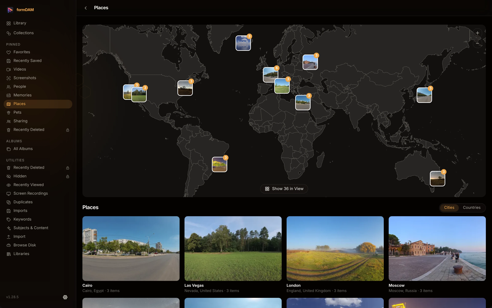

<p align="center">
  
</p>

<h1 align="center">FormDAM</h1>

<p align="center">
  <b>Photo library; a local-first asset manager for the Form family.</b><br>
  A SQLite catalog, RAW and HEIC, search, maps, a non-destructive editor and private albums,<br>
  on your machine with no account. Nothing leaves it unless you send it.
</p>

<p align="center">
  
  
  
  
  
</p>

<p align="center">
  <a href="https://formdam.formai.studio/"><b>Download FormDAM on formai.studio</b></a> ·
  <a href="https://github.com/nodemode-dev/formcompiler/releases?q=formDAM-v&expanded=true">Latest release</a> ·
  <a href="#run-it-from-source">Run it from source</a>
</p>

<br>

<p align="center">
  
  <br>
  <sub>The Library in All Photos view, 62 items grouped by day.</sub>
</p>

<p align="center">
  <a href="#features">Features</a> · <a href="#everything-in-the-box">In the box</a> · <a href="#under-the-hood">Under the hood</a> · <a href="#download">Download</a> · <a href="#run-it-from-source">Run from source</a>
</p>

<table>
  <tr>
    <td width="25%" valign="top">
      <h3>Local-first</h3>
      The engine answers only loopback connections, and no photo, coordinate or query leaves your machine.
    </td>
    <td width="25%" valign="top">
      <h3>Finds anything</h3>
      One search over text, dates and places, plus CLIP visual search, run on device with permissively licensed models.
    </td>
    <td width="25%" valign="top">
      <h3>Non-destructive</h3>
      Edits, XMP sidecars and a 30-day Recently Deleted vault keep every original safe and every change reversible.
    </td>
    <td width="25%" valign="top">
      <h3>Private by design</h3>
      Passkey-locked albums, encrypted sharing packages and opt-in sync, with private items never leaving.
    </td>
  </tr>
</table>

## Features

<table>
  <tr>
    <td width="50%" valign="top">
      
      <br><sub>The viewer with its info panel.</sub>
      <h3>Look closely, organize fast</h3>
      Full-size photos and video with ratings, colour labels, keywords, location and exposure beside them. Everything works from the keyboard.
    </td>
    <td width="50%" valign="top">
      
      <br><sub>The non-destructive editor, Adjust tab.</sub>
      <h3>Edit without touching the original</h3>
      Light, colour, curves, filters, crop, markup and Clean Up, all revertible. Copy and paste edits across photos.
    </td>
  </tr>
  <tr>
    <td width="50%" valign="top">
      
      <br><sub>Places: an offline map with clustered thumbnails.</sub>
      <h3>Your library on a map</h3>
      Offline reverse geocoding turns GPS into city and country collections and trips. No map tiles are fetched.
    </td>
  </tr>
</table>

## Everything in the box

<table>
  <tr>
    <td width="33%" valign="top">
      <h4>Library and organize</h4>
      Years, Months, All Photos · quick filters · stacks · 0 to 5 stars · colour labels · hierarchical keywords · smart albums · album folders · batch rename · Advanced Find
    </td>
    <td width="33%" valign="top">
      <h4>Recognition, on device</h4>
      People and pets · Look Up (species, breeds, landmarks, artworks, foods) · Clean Up with LaMa · documents, receipts, QR codes · CLIP search
    </td>
    <td width="33%" valign="top">
      <h4>Formats</h4>
      Opens: JPEG, PNG, WebP, TIFF, HEIC and HEIF, 23 camera RAW extensions, video via ffmpeg · Saves: JPEG, HEIC, PNG, TIFF, WebP · Sidecars: XMP
    </td>
  </tr>
</table>

## Under the hood

- **Engine:** FastAPI and a SQLite catalog (`dam.db`) in a library folder you choose; originals are copied, moved or referenced in place, SHA-256 fingerprinted.
- **Interface:** vanilla TypeScript and Vite with inline `currentColor` icons; the engine can serve the built UI itself.
- **Desktop:** a Tauri shell over the engine frozen with PyInstaller; the bundle is built by `./build_app` or by FormCompiler.
- **Local only:** a per-launch key is traded for an HttpOnly session cookie, and automation access for scripts is off until Settings > Privacy turns it on.

## Download

| Platform | Download | Release |
|---|---|---|
| macOS | [Download FormDAM for macOS](https://formai.studio/get/formdam/macos) | [FormDAM releases on FormCompiler](https://github.com/nodemode-dev/formcompiler/releases?q=formDAM-v&expanded=true) |
| Windows | [Download FormDAM for Windows](https://formai.studio/get/formdam/windows) | [FormDAM releases on FormCompiler](https://github.com/nodemode-dev/formcompiler/releases?q=formDAM-v&expanded=true) |
| Linux | [Download FormDAM for Linux](https://formai.studio/get/formdam/linux) | [FormDAM releases on FormCompiler](https://github.com/nodemode-dev/formcompiler/releases?q=formDAM-v&expanded=true) |

All FormDAM builds are compiled and released from [FormCompiler](https://github.com/nodemode-dev/formcompiler); this repo holds the source.

## Run it from source

Prefer it in your browser, or want to contribute? Run the web UI straight from this repo.

**Requires:** Python 3.10+, Node 20.19 or 22.12+. `ffmpeg` on PATH is optional and adds video thumbnails and video scanning.

```sh
git clone git@github.com:nodemode-dev/formDAM.git
cd formDAM
setup/formDAM_oc_install   # backend venv, pip deps, models (about 1.2 GB downloaded once, sha256-pinned), npm install
./formDAM                  # installs what is missing, boots, opens http://127.0.0.1:5173
```

`./build_app` builds the desktop app instead. On Windows use `formDAM.bat`. Set `FORMDAM_LIBRARY` to choose the library folder (default `<repo>/library`).

| Service | URL | Notes |
|---|---|---|
| Interface | http://127.0.0.1:5173 | Vite dev server; open it with the launch key the boot script prints |
| Engine | http://127.0.0.1:8000 | FastAPI; serves the built UI too after `cd frontend && npm run build` |

**Contributing:** branch from `main`, keep changes to source here, and leave packaging and releases to FormCompiler. See [`CLAUDE.md`](CLAUDE.md) for the repo rules.

## Repository

| Path | What it is |
|---|---|
| `backend/` | FastAPI engine and SQLite catalog; `app/dedup` is the vendored deduplakit core |
| `frontend/` | Vanilla TypeScript and Vite interface |
| `src-tauri/` | Tauri desktop shell |
| `setup/` | Install, boot and build scripts for macOS, Linux and Windows |

---

## Maintainers

| Maintainer | Role |
|---|---|
| [@nodemode-ai](https://github.com/nodemode-ai) | Owner |
| [@gbarnai](https://github.com/gbarnai) | Co-owner |

Code owners are set in [`.github/CODEOWNERS`](.github/CODEOWNERS).

## License

FormDAM is licensed under the Apache License 2.0 ([`LICENSE`](LICENSE), SPDX `Apache-2.0`). Copyright 2026 NodeAgentc, Inc. Third-party notices: [`NOTICE.md`](NOTICE.md), [`LICENSES.md`](LICENSES.md). FormDAM was MIT licensed up to v1.27.5.

This product includes DNG technology under license by Adobe Systems Incorporated.
<sub>Adobe, Bridge, Lightroom and Photoshop are trademarks of Adobe, and Apple and Photos are trademarks of Apple Inc. FormDAM is an independent project and is not affiliated with or endorsed by them; the names describe file formats and compatibility only.</sub>

<sub>Screenshot content: CC0 photos from Poly Haven.</sub>
